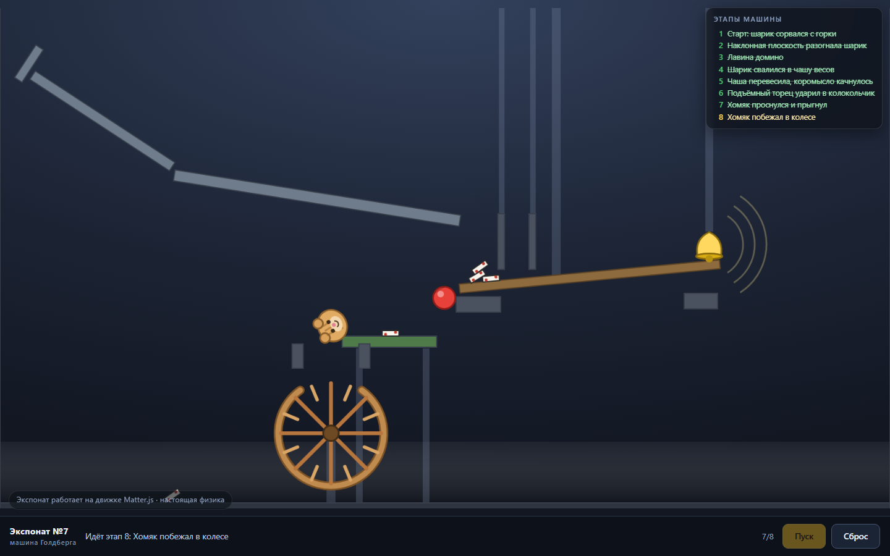
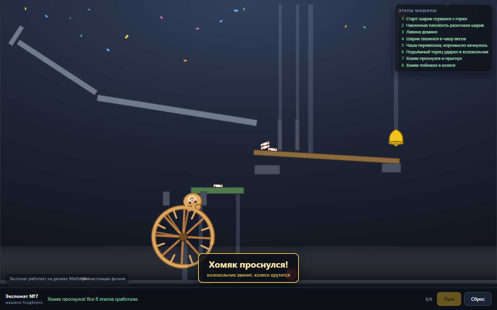

# Экспонат №7 — машина Голдберга «Разбудить хомяка»

> Музейный экспонат, который стоит в очереди из детей: один клик — и цепная реакция
> из восьми звеньев будит спящего хомяка самым нелепым способом.
> **Настоящая физика, никакой анимации, которая притворяется физикой.**



**[▶ Открыть экспонат](https://teflon11.github.io/hamster-goldberg-machine/)** — работает без сборки, без сервера и без интернета.

---

## Запуск

```bash
git clone https://github.com/teflon11/hamster-goldberg-machine.git
```

Откройте `index.html` двойным кликом. Всё — Matter.js 0.20.0, вся сцена, вся
логика и весь звук уже внутри одного файла (≈120 КБ). Никаких `npm install`,
внешних шрифтов, CDN и картинок.

Нажмите **«Пуск»**. Звук появляется после первого клика — так работает политика
браузеров к AudioContext.

---

## Восемь этапов

| # | Этап | Условие прохождения | Момент, с модельного времени |
|---|------|--------------------|------------------------------|
| 1 | Старт: шарик сорвался с горки | смещение > 20 px | 0,33 с |
| 2 | Наклонная плоскость разогнала шарик | `x > 300` | 1,35 с |
| 3 | Лавина домино | все 5 плашек легли (│угол│ > 0,45) | 2,52 с |
| 4 | Шарик свалился в чашу весов | попал в люльку коромысла | 4,12 с |
| 5 | Чаша перевесила, коромысло качнулось | `angle < −0,10` | 4,1–4,4 с |
| 6 | Подъёмный торец ударил в колокольчик | столкновение `beam ↔ bell` | 4,42 с |
| 7 | Хомяк проснулся и прыгнул | смещение > 45 px | 4,62 с |
| 8 | Хомяк побежал в колесе | накат колеса > 2,4 рад | 6,52 с |

Полный прогон — около **6,5 с**. Кнопка **«Сброс»** пересоздаёт сцену заново и
возвращает ровно в исходное состояние.



---

## Почему это настоящая физика, а не анимация

В файле нет ни одного CSS-`transition`/`@keyframes` и ни одного присваивания
`body.position = …` для движения тел. Всё движение — результат работы решателя.

Гарантии, которые обеспечены кодом, а не обещанием:

- **Фиксированный шаг 1/60 с.** Симуляция ведёт себя одинаково на любой машине
  и при любом FPS; `Runner` с переменным `delta` не используется.
- **Детерминированность.** В физике нет `Math.random`. Значит «срабатывает
  каждый раз» сводится к «сработало один раз при неизменном шаге» — и это
  проверяемо, а не на веру.
- **Посадочная фаза.** Перед «Пуском» сцена прогоняется 150 шагов вхолостую,
  чтобы все тела успокоились именно под гравитацией, а не под стартовыми
  допущениями.
- **Watchdog.** У каждого этапа свой дедлайн 8 с и общий потолок 75 с. Если
  цепь где-то глохнет, экспонат сам показывает, на каком именно этапе:
  «Стоп: Лавина домино».
- **Два помеченных исключения.** Прыжок хомяка и «бег в колесе» — это
  `applyForce` (импульс и пара сил), а не перестановка тела; в коде они
  размечены комментарием `EXCEPTION`. Момент пары выбран специально: его
  равнодействующая нулевая, то есть это чистый вращающий момент, который
  физически создаёт лапка хомяка на перекладине.

---

## Что под капотом

| Параметр | Значение |
|---|---|
| Движок | Matter.js 0.20.0 (инлайн, MIT-баннер сохранён) |
| Мир | 1600 × 900 px, гравитация `y = 1` |
| Шаг | 1000/60 мс, до 5 подшагов за кадр |
| Итерации | position 10 · velocity 10 · constraint 6 |
| Посадка | 150 шагов до старта |
| Дедлайн этапа / машины | 8 с / 75 с |
| Тела в сцене | 24, из них 9 динамических: шарик, 5 домино, коромысло, хомяк, колесо |

Рендер — собственная отрисовка на canvas, а не `Matter.Render`: тела рисуются по
фактическим вершинам, поэтому нарисованное и столкновительное совпадают. Колесо
и хомяк получают отдельную отрисовку (обод со спицами, мордочка, «z-z-z» во сне),
но их геометрия по-прежнему берётся из тел.

Canvas масштабируется с сохранением пропорций (`object-fit: contain`), поэтому
физика не зависит от размера окна: на узком экране меняются только пиксели,
а не координаты и момент силы.

---

## Структура репозитория

```
index.html              — экспонат: сцена, физика, отрисовка, звук, интерфейс
promtFlash.md           — техническое задание и разбор реализации
README.md
.gitignore              — node_modules, .qwen/, мусор приёмки
.gitattributes          — LF во всём текстовом; index.html не должен меняться при checkout

docs/preview.png        — кадр в момент звона (7/8 этапов)
docs/preview-final.png  — финальный кадр, все 8 этапов

dev/                    — харнес сборки и приёмки (в репозитории, не нужен для показа)
  src/core.js           — физическое ядро, без зависимостей от DOM
  src/app.js            — отрисовка на canvas, интерфейс, звук
  src/page.html         — шаблон страницы с метками вставки
  build.js              — склейка в один автономный index.html
  clash.js              — проверка сборки: нет ли пересечений тел до 1-го шага
  test.js               — 5 прогонов ядра в чистом Node
  verify.js             — 5 прогонов в headless-браузере + 6 размеров окна
  verify-live.js        — живой путь: клик «Пуск» → ожидание → «Сброс»
  inspect.js            — контроль автономности готового index.html
  readme-check.js       — сверяет утверждения README с кодом
  preview.js            — пересоздаёт картинки из docs/
  paths.js              — все пути относительно корня репозитория
```

---

## Как повторить приёмку

Приёмка — **5 подряд успешных прогонов**. Она идёт в два слоя: сначала чистый
Node (быстрые итерации по геометрии), потом настоящий браузер.

Харнес лежит в `dev/` и полностью относительный: пути выводятся из расположения
скриптов, поэтому работает из любого клона и никуда не «прописывается». Для
показа экспоната он не нужен — только если вы меняете сцену.

```bash
cd dev
npm i
```

Дальше (нужен Node 20+; для браузерной части — Microsoft Edge или Chrome):

```bash
node clash.js        # сборка без взаимных пересечений тел
node test.js 5       # 5 прогонов ядра в чистом Node
node verify.js       # 5 прогонов + 6 размеров окна + ловля ошибок страницы
node verify-live.js  # живой путь: клик «Пуск» → ожидание → «Сброс»
```

Если вместо Edge у вас Chrome: `QWEN_CHANNEL=chrome node verify.js`. Промежуточные
скриншоты приёмки уходят в `%TEMP%`, рабочую директорию не засоряют; перебить —
`QWEN_SHOTS=D:/tmp/shots`.

Что проверяет каждый слой:

- **`clash.js`** перебирает все пары тел **до первого шага** и ищет
  пересечения. Стартовое взаимное перекрытие решатель разрешает мгновенным
  выбросом — скорости в сотни px/шаг, затем `NaN`, и дальше уже виноват не тот
  узел, который видно на экране. Это самая дешёвая проверка и самая важная.
- **`test.js 5`** гоняет ядро в Node и печатает номер и имя этапа при зависании.
- **`verify.js`** открывает `file:///…/index.html` в headless Edge, собирает
  `pageerror`/`console`, прогоняет 5 раз, снимает кадры и проверяет, что нижняя
  панель целиком влезает в шесть размеров окна — включая намеренно низкое
  1440 × 560.
- **`verify-live.js`** проверяет то, что делают руками: настоящий клик по кнопке
  и ожидание в реальном времени, а не синхронный «докрутить до конца».

---

## Грабли Matter.js, на которые мы наткнулись

Они же — причины, почему сцена устроена именно так. Будет полезно, если вы
будете менять геометрию.

1. **Составное тело сталкивается по выпуклой оболочке своих частей.**
   `Body.create({parts})` делает телом-родителем не объединение частей, а их
   *convex hull*, и границы broadphase берёт тоже от него. Из-за этого нельзя
   сделать составной «стакан» с выемкой: фантомная горбина выталкивает
   собственный шарик и проглатывает соседние детали. Все чаши и люльки здесь —
   одиночные прямоугольники или статические стенки.
2. **`Body._totalProperties` не добавляет `m·d²`.** Момент инерции составного
   тела суммируется вокруг центров отдельных частей, без параллельного
   переноса. Для оси вдали от центра масс это заниженный момент — и шарнир
   взрывается. Инерцию приходится пересчитывать вручную.
3. **Составное тело на вынесенной оси неустойчиво, одиночный прямоугольник на
   такой же — устойчив.** Проверено сравнением. Отсюда правило: рычаги с осью
   не в центре масс — всегда одиночные планки.
4. **Шарнир плюс вторая опора на том же теле = переизбыточная связь.** Лоток,
   прикреплённый с одного конца и подпертый с другого, Matter решал мгновенным
   выбросом шарика. Либо ось, либо опорный контакт — но не оба сразу.
5. **`density` в `Body.create({parts})` молча игнорируется** — массу надо
   ставить отдельно через `Body.setDensity` после создания.
6. **`frictionAir` глушит качение сильнее, чем кажется.** При 0,003 шарик
   доползал до домино и глох; нужно ~0,001. Плюс горка 33°, а не 20°.
7. **Тело, «замороженное» через `isStatic: true` и потом отпущенное
   `Body.setStatic(false)`,** дало `NaN` на первом же шаге. Стартовый шарик
   теперь удерживается не заморозкой, а настоящей физической щеколдой, которую
   «Пуск» убирает из мира.

---

## Известные особенности

- **Этапов восемь, а не тринадцать.** В исходном плане (`promtFlash.md`) было
  тринадцать. Дополнительные звенья со вторым перекатывающимся шаром — лоток на
  двух опорах, воронка, съезд, стойка-защёлка — переписывались полтора десятка
  раз: каждое новое шарнирное соединение добавляло режим, в котором цепь либо
  взрывалась, либо глохла. Требование «минимум 8 этапов» выполнялось, требование
  «срабатывает каждый раз» — нет. Выбрана надёжность.
- **Прогон всегда выглядит одинаково.** Это прямое следствие детерминизма и
  осознанная плата за «срабатывает каждый раз». Повторов с вариациями нет.
- **Звук не играет до первого клика** — ограничение браузеров, не багаж.
- **Файл не лицензирован.** В репозитории пока нет `LICENSE`. Часть Matter.js
  распространяется под MIT, её баннер сохранён внутри `index.html`; для своего
  кода лицензию нужно выбрать отдельно.

---

## Технологии

`Matter.js 0.20.0` · Canvas 2D · WebAudio (синтез, без аудиофайлов) ·
чистый JavaScript, без фреймворков и сборки · приёмка через `playwright-core` +
Microsoft Edge в headless.

---

Сделано как одностраничный экспонат: один файл, двойной клик, работает офлайн.
